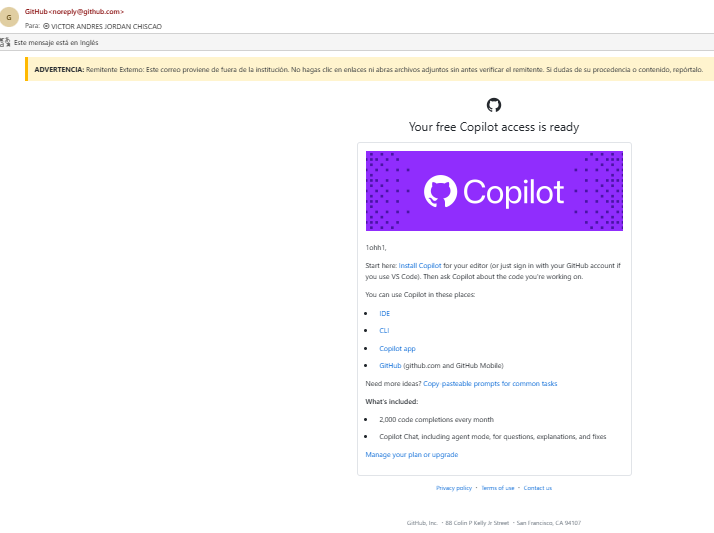
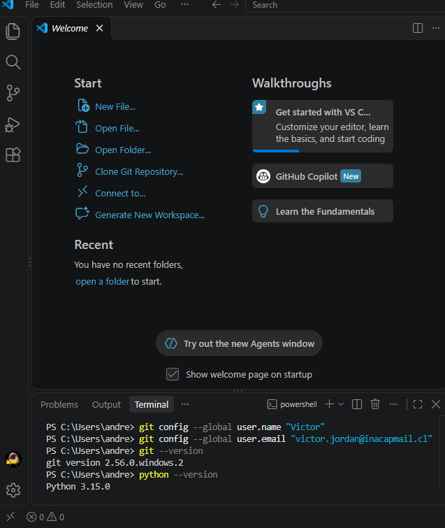
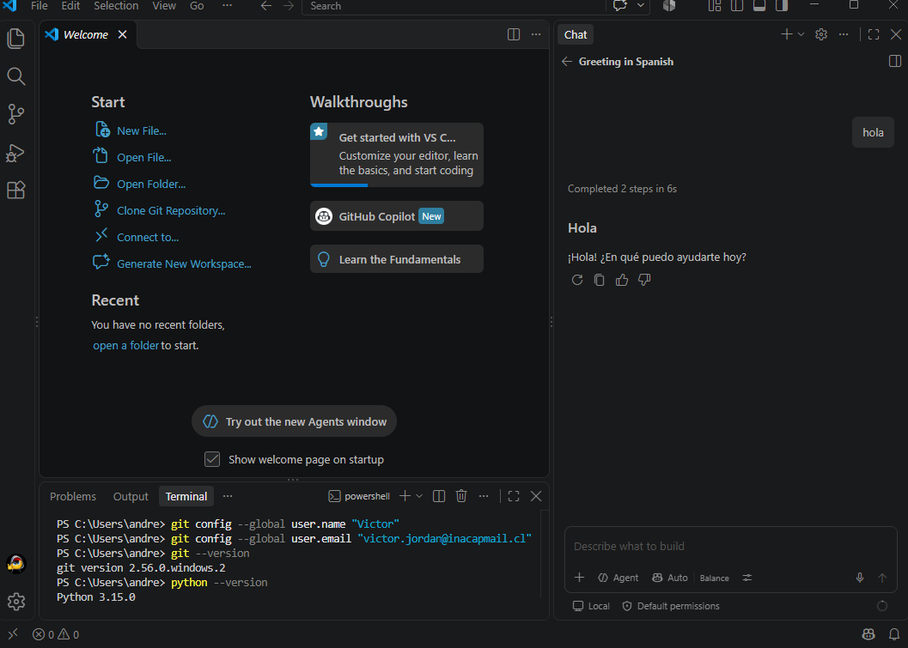
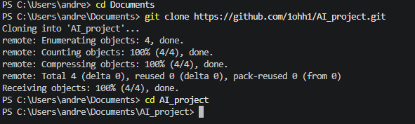
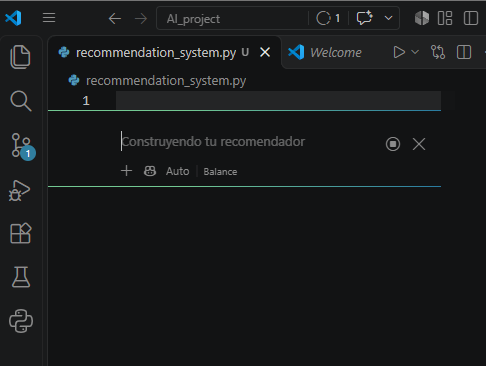
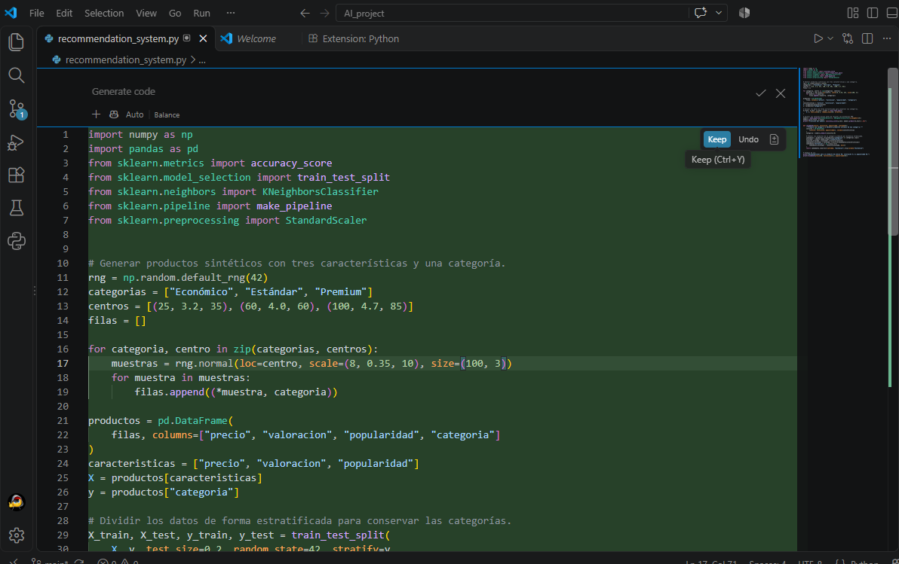
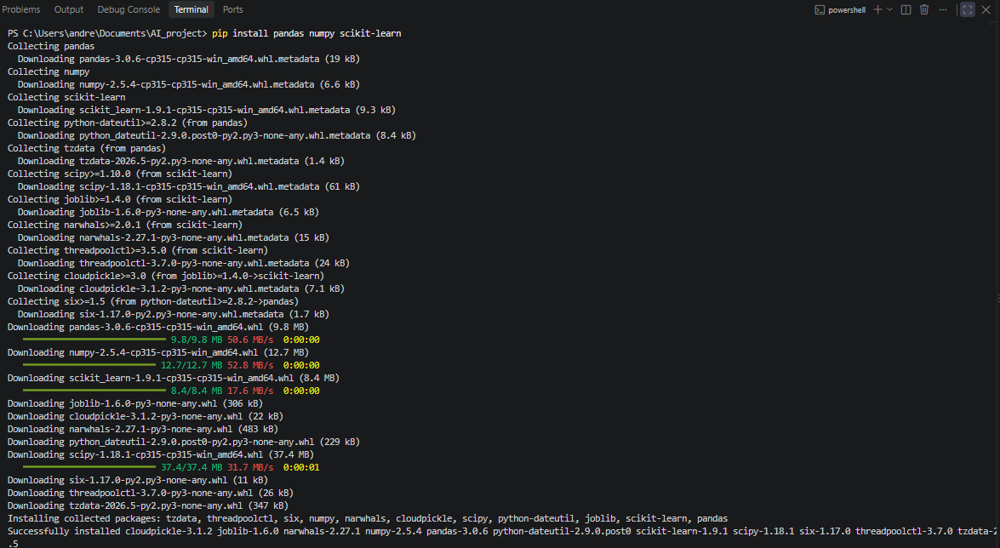
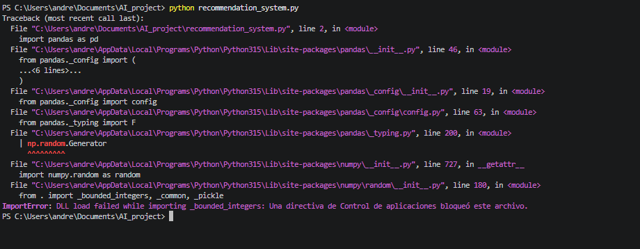
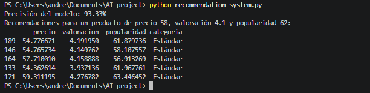

# AI_Project – Sistema de recomendación con GitHub Copilot

**Asignatura:** ETVI02 – Tendencia de la IA aplicada (INACAP)

**Actividad:** Actividad formativa: GitHub Copilot

**Autor:** Victor Jordan Chiscao – ETVI02

## Descripción
Este proyecto explora GitHub Copilot como herramienta de IA generativa aplicada al desarrollo de software. Con Copilot se generó un sistema de recomendación de productos en Python que usa el algoritmo K-Nearest Neighbors (KNN) de scikit-learn.

## 1. Activación de GitHub Copilot
Se creó una cuenta en GitHub y se activó el plan **Copilot Free**, que incluye completado de código y Copilot Chat.

## 2. Preparación del entorno
Se instalaron Git y Python en Windows y se configuró Git con nombre y correo. Se verificaron las versiones instaladas:

Luego se inició sesión con GitHub en Visual Studio Code y se comprobó que Copilot Chat respondía correctamente:

## 3. Creación y clonación del repositorio
Se creó el repositorio público `AI_project` en GitHub con README y `.gitignore` de Python, y se clonó localmente con:

    git clone https://github.com/1ohh1/AI_project.git
    cd AI_project

## 4. Generación del código con GitHub Copilot
Se creó el archivo `recommendation_system.py` y, con el chat en línea de Copilot (Ctrl + I), se le pidió generar un sistema de recomendación con KNeighborsClassifier, usando datos de ejemplo creados dentro del mismo script.

El código generado:
- Crea 300 productos sintéticos con precio, valoración y popularidad, clasificados en Económico, Estándar y Premium.
- Divide los datos en entrenamiento (80 %) y prueba (20 %).
- Entrena un modelo KNN con escalado de datos.
- Calcula la precisión del modelo.
- Recomienda los productos más similares a uno de ejemplo.

## 5. Ejecución y solución de problemas
Se instalaron las librerías necesarias:

    pip install pandas numpy scikit-learn

Al ejecutar el script, Windows bloqueó una librería de numpy mediante el **Control inteligente de aplicaciones**:

Se desactivó esta función desde Seguridad de Windows y el programa se ejecutó correctamente:

    python recommendation_system.py

**Resultado:** el modelo alcanzó una precisión de **93,33 %** y recomendó 5 productos de categoría "Estándar" similares al producto de ejemplo.

## Conclusión
GitHub Copilot permitió generar en pocos segundos un sistema de recomendación funcional a partir de una instrucción en lenguaje natural, lo que muestra cómo la IA generativa está cambiando la forma de programar. Aun así, fue necesario revisar el código, preparar el entorno y resolver problemas del sistema operativo, lo que confirma que estas herramientas apoyan al desarrollador pero no lo reemplazan.